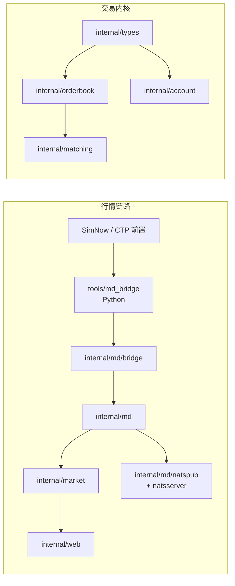

# 模块文档

本目录按 Go 包 / 可执行入口拆分说明，便于按模块阅读与维护。

## 架构总览

| 文档 | 模块 | 状态 |
|------|------|------|
| [types.md](./types.md) | `internal/types` | 交易领域类型 |
| [errs.md](./errs.md) | `internal/errs` | 订单错误定义 |
| [orderbook.md](./orderbook.md) | `internal/orderbook` | 订单簿 |
| [matching.md](./matching.md) | `internal/matching` | 撮合引擎 |
| [account.md](./account.md) | `internal/account` | 账户/资金 |
| [config.md](./config.md) | `internal/config` | Postgres 初始化 |
| [global.md](./global.md) | `internal/global` | 全局 DB 句柄 |
| [api.md](./api.md) | `internal/api` | 交易 API（占位） |
| [md.md](./md.md) | `internal/md` | 行情 Tick / Source / Publisher |
| [md-bridge.md](./md-bridge.md) | `internal/md/bridge` + `tools/md_bridge` | CTP 桥 |
| [md-nats.md](./md-nats.md) | `internal/md/natspub` + `natsserver` | JetStream 总线 |
| [market.md](./market.md) | `internal/market` | 行情热缓存 |
| [web.md](./web.md) | `internal/web` | 行情展示后端 + 前端 |
| [cmd-md-ingest.md](./cmd-md-ingest.md) | `cmd/md-ingest` | 行情抓取进程入口 |

## 阅读顺序建议

1. 行情展示现状：`md.md` → `md-bridge.md` → `md-nats.md` → `market.md` → `web.md` → `cmd-md-ingest.md`
2. 交易内核：`types.md` → `orderbook.md` → `matching.md` → `errs.md`
3. 账务与持久化：`account.md` / `config.md` / `global.md`

相关产品背景见 [../project/PROJECT.md](../project/PROJECT.md)。
