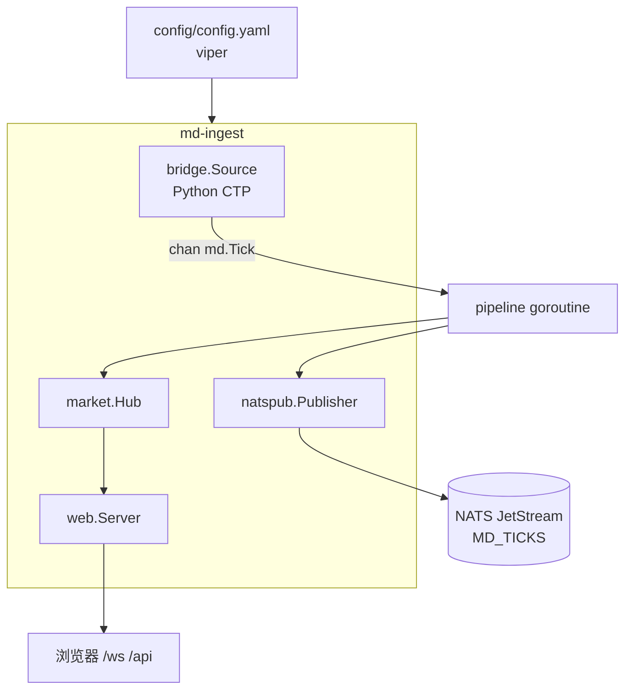

# cmd/md-ingest — 行情抓取进程入口

**路径：** `cmd/md-ingest/main.go`  
**职责：** 装配整条行情管道：CTP 桥 → 热缓存 → JetStream → Web 展示。  
**不负责：** 撮合下单、账户结算。

## 进程内数据流



## 启动步骤

1. 读配置（viper：`config/config.yaml`，缺省可单独跑）
2. 可选启动 **内嵌 NATS JetStream**（`nats.embedded`）
3. 连接 NATS，初始化 `natspub`（确保 stream 存在）
4. 启动 `market.Hub` + pipeline：`OnTick` + `Publish`
5. 启动 Python 桥 `bridge.Source`
6. 启动 HTTP（`web.Server.Handler`）

优雅退出：`SIGINT/SIGTERM` → 关 HTTP → 取消 ctx → 等 pipeline。

## 配置

```yaml
listen: "127.0.0.1:8088"

bridge:
  python: python
  script: tools/md_bridge/md_bridge.py
  front: "tcp://182.254.243.31:40011"
  broker: "9999"
  user: ""
  password: ""
  symbols: [cu2611, al2611, rb2701, au2612]

nats:
  embedded: true
  port: 4222
  store_dir: data/nats
  url: "nats://127.0.0.1:4222"
```

## 运行

```powershell
pip install openctp-ctp
go build -o bin/md-ingest.exe ./cmd/md-ingest
.\bin\md-ingest.exe
# UI:  http://127.0.0.1:8088/
# API: http://127.0.0.1:8088/api/quotes
```

## 验收清单

- [x] 日志出现 bridge subscribe / tick
- [x] `/api/quotes` 四合约价格刷新
- [x] `/ws` 收到 snapshot/tick/kline
- [x] JetStream `MD_TICKS` 有消息（subject `md.tick.*`）

## 后续演进

- 拆成 `md-ingest` / `web` 多进程时：web 改为订阅 JetStream 重建 Hub
- Source 可插拔 HTTP 快照；Publisher 可换 Kafka
- 交易侧 `internal/api` 与本进程解耦，共用行情时经 JetStream 即可
